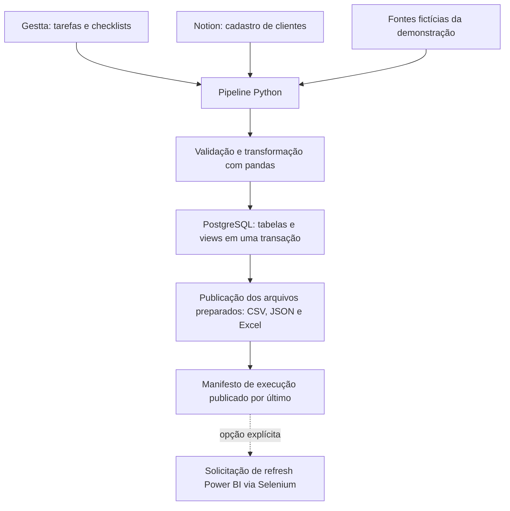

# Gestão Geral BI

[](https://github.com/GabrielTIAlef/gestao_geral/actions/workflows/tests.yml)

Solução de integração de dados e **Business Intelligence operacional**, desenvolvida
em contexto empresarial com Python, PostgreSQL, Gestta, Notion, Power BI e RPA.
Apoia o acompanhamento de tarefas, equipes, onboarding e fluxos operacionais.

A versão pública reúne um pipeline confiável, demonstração com dados fictícios,
testes de falhas e integração contínua. Este README apresenta tanto a experiência
corporativa original quanto o que pode ser reproduzido e verificado no repositório.

Esta versão pública utiliza nomes de etapas, filtros e registros demonstrativos.
É possível avaliar o ETL sem contas de Gestta, Notion, Slack ou Power BI.

## Origem e contexto empresarial

O projeto nasceu para centralizar e automatizar dados operacionais de uma
empresa contábil. A operação acompanhava milhares de tarefas e processos
diariamente, com informações distribuídas entre Gestta, Notion e rotinas de
acompanhamento manual.

A implantação integrou Python, PostgreSQL, APIs REST, Power BI e automação de
navegador para apoiar a gestão de tarefas, equipes, onboarding de clientes e
monitoramento de fluxos operacionais.

Os desafios atendidos incluíam a demora na atualização dos painéis, a dependência
de planilhas manuais, a dificuldade de visualizar gargalos e a necessidade de
oferecer uma visão consolidada com baixo custo operacional. A disponibilidade das
interfaces de integração na implantação original também exigiu adequar as
coletas às necessidades da operação.

### Processos e integrações da implantação original

| Componente | Aplicação no contexto empresarial |
| --- | --- |
| Gestta | Coleta de tarefas, responsáveis, status, prazos e etapas de checklist. |
| Notion | Integração dos cadastros e propriedades associados aos clientes e ao onboarding. |
| Python e pandas | Extração, normalização, tratamento de datas e consolidação das bases. |
| PostgreSQL e SQL | Centralização relacional e views para consumo analítico. |
| Power BI e DAX | Modelagem analítica, indicadores e dashboards operacionais. |
| Selenium / RPA | Automação de interações no Power BI Web para solicitar atualizações. |
| Slack Webhooks | Alertas operacionais e de falhas do processamento. |
| Windows Task Scheduler | Agendamento das rotinas no ambiente da implantação original. |

A descrição acima recupera a experiência corporativa do projeto. Arquivos de
dashboard, medidas DAX, agendamentos, sessões autenticadas e configurações da
empresa não fazem parte da distribuição pública. A documentação atual usa os
nomes reais dos módulos publicados, apresentados mais adiante.

## Dashboards e indicadores utilizados na operação

Na implantação corporativa foram desenvolvidos os seguintes painéis:

| Dashboard | Finalidade | Indicadores e análises |
| --- | --- | --- |
| Operacional | Acompanhar tarefas, equipes e execução da operação. | Quantidade de tarefas, status, SLA, produtividade, desempenho individual e por setor, evolução temporal e atrasos. |
| Atendimento | Acompanhar demandas e o fluxo de trabalho do atendimento. | Volume e criação de demandas, tempo de resposta, fluxo operacional e acompanhamento da equipe. |
| Apuração | Acompanhar etapas dos processos fiscais e operacionais. | Status das etapas, fluxos pendentes, processos críticos e gargalos. |

O acompanhamento de onboarding e checklists apoiava a identificação de etapas
pendentes e gargalos na entrada de clientes.

Esses painéis e indicadores integram a história profissional da solução. A versão
pública preserva a preparação dos dados e views demonstrativas; não contém
`.pbix`, medidas DAX nem capturas dos painéis corporativos. Suas regras,
denominadores e metas empresariais não são reconstruídos com dados confidenciais.

## Resultados observados no ambiente corporativo

Os resultados abaixo foram descritos no README original e confirmados pelo autor
como observados na implantação corporativa. O escopo é o fluxo atendido pela
solução; os números não são um benchmark da demonstração pública.

| Aspecto | Antes | Depois da implantação |
| --- | --- | --- |
| Atualização dos painéis | 5 dias | Menos de 5 minutos |
| Dependência de planilhas manuais no fluxo atendido | Alta | Eliminada |
| Centralização das fontes atendidas | Parcial | Completa no escopo da solução |
| Atualização operacional | Manual | Automatizada |
| Monitoramento de erros | Limitado | Alertas via Slack |

A comparação de atualização se refere ao resultado observado na operação,
conforme relato do autor. Não equivale a uma garantia de tempo de execução do
ETL público ou à confirmação automática de conclusão de refresh no Power BI.
Logs corporativos e medições comparativas não são publicados neste repositório.

## O que esta versão pública permite comprovar

A experiência corporativa explica o problema de negócio, os dashboards e o impacto
profissional. O repositório público oferece uma implementação adaptada para
avaliação técnica, com dados fictícios, testes e instruções de reprodução.

| Camada | O que é apresentado | Evidência disponível |
| --- | --- | --- |
| Experiência corporativa | Contexto, processos, dashboards e resultados observados. | Relato profissional do autor, recuperado do README original. |
| Versão pública | Coletores e transformações adaptados, transações, views, arquivos, validações e tratamento de falhas. | Código publicado e testes com respostas HTTP simuladas. |
| Demonstração reproduzível | Fluxo com dados sintéticos e PostgreSQL real descartável. | Amostra gerada, saídas e registros de validação. |
| Integração contínua | Execução automatizada dos testes no GitHub. | Workflow e histórico de execuções do GitHub Actions. |

As melhorias de engenharia acrescentadas à versão pública são descritas abaixo.
Elas não significam que a implantação corporativa tenha sido novamente
homologada ou que todos os seus dashboards sejam reproduzidos pela amostra.

## Objetivo técnico da versão pública

Dados distribuídos entre ferramentas dificultam relacionar tarefas e clientes e
construir uma base analítica consistente. O projeto centraliza essas fontes em
um fluxo de extração, transformação e carga, com validações antes de substituir
os dados publicados.

O foco técnico da versão pública é a confiabilidade da base para BI. O código
permite avaliar a integração e a publicação dos dados sem restaurar os artefatos
ou as configurações privadas da implantação original.

## Arquitetura da versão pública



As fontes fictícias substituem os coletores reais na demonstração. Os arquivos
são preparados antes da carga, mas publicados depois do commit do banco.
**Não há transação distribuída** entre PostgreSQL e sistema de arquivos.

## Decisões de engenharia

| Necessidade | Implementação |
| --- | --- |
| Integrar fontes da mesma execução | Pipeline coleta Notion e Gestta; reprocessamento de CSV exige manifesto com hashes válidos. |
| Evitar lotes parciais silenciosos | Falhas de extração, contratos inesperados, chaves inválidas e lotes totais vazios interrompem a carga. |
| Preservar tabelas e dependências | Schema validado, `DELETE` e inserção na mesma transação; views sem `DROP ... CASCADE`. |
| Evitar cargas concorrentes | Advisory locks no PostgreSQL protegem execução e publicação. |
| Preservar zeros iniciais | CNPJ como texto; entrada numérica é rejeitada, sem tentar reconstruir o identificador. |
| Detectar arquivos incompatíveis | Arquivos temporários e manifesto com SHA-256 publicado por último. |
| Acompanhar falhas | Logs por etapa, contagens, manifesto e testes de rollback. |

A integração principal usa `LEFT JOIN` das tarefas com o cadastro Notion pelo
código do cliente. Exige chave única no cadastro e mantém tarefas sem
correspondência, registrando sua contagem.

## Demonstração local

Pré-requisitos deste roteiro: **Windows, Python 3.12 e binários portáteis do
PostgreSQL 18.6**. Consulte o [guia de reprodução](docs/REPRODUCAO.md) para obter
e localizar os binários. Na raiz do repositório, em PowerShell:

```powershell
python -m venv .venv
.\.venv\Scripts\python.exe -m pip install -r requirements-lock.txt
.\.venv\Scripts\python.exe -m pip check

# Ajuste para o diretório bin do PostgreSQL que você extraiu.
$PgBin = (Resolve-Path '.local-test\runtime\pgsql\bin').Path
.\.venv\Scripts\python.exe -X utf8 scripts/validate_postgres.py --pg-bin "$PgBin" --demo
```

O comando cria um cluster temporário local, executa a suíte completa e a
demonstração, e encerra o servidor ao terminar. Não exige `.env` nem credenciais
corporativas. O script não baixa PostgreSQL automaticamente.

A demonstração contém **5 tarefas, 2 clientes na fonte Notion e 4 itens de
checklist**, incluindo uma tarefa sem cadastro correspondente. Gera em
`data/demo/`: `gestta.csv`, `notion.csv`, `gestta.json`, `resultado.xlsx` e
`latest_run.json`. Esses arquivos e o cluster local são ignorados pelo Git.

## Testes e evidências

- **72 testes aprovados no Windows**, em duas instalações novas, sem falhas,
  erros ou testes ignorados: [relatório](docs/ETAPA_3_VALIDACAO.md) e
  [resultado registrado](docs/evidence/etapa3_resultado.json).
- **14 testes com PostgreSQL real**, cobrindo cargas, views, rollback de dados
  e DDL, concorrência, CNPJ textual e fluxo com HTTP simulado. Os demais cobrem
  transformação, configuração e tratamento de falhas.
- **Execução aprovada no GitHub/Linux** após a integração do CI:
  [registro da execução](https://github.com/GabrielTIAlef/gestao_geral/actions/runs/39342727864).
  Novas propostas e envios à `main` executam a suíte com PostgreSQL obrigatório;
  consulte [testes automáticos](docs/TESTES_AUTOMATICOS.md).

Para executar somente os testes disponíveis sem iniciar PostgreSQL:

```powershell
.\.venv\Scripts\python.exe -X utf8 scripts/run_tests.py
```

Nesse modo os testes PostgreSQL são explicitamente ignorados: **não equivale à
validação completa**. O CI usa `--require-postgresql` e falha se houver omissões.

## Organização do código

| Caminho | Responsabilidade |
| --- | --- |
| [src/pipeline.py](src/pipeline.py) | Coordena fontes, transformação, carga e saídas. |
| [src/extracao/](src/extracao/) | Coletores Notion e Gestta, sem integrações na importação. |
| [src/transformacao/PBI_OS.py](src/transformacao/PBI_OS.py) | Normalização, validação da junção e definições das views. |
| [src/transformacao/CS.py](src/transformacao/CS.py) | Coleta e validação dos checklists. |
| [src/database.py](src/database.py) | Transações, tipos, schema e locks. |
| [src/etl_support.py](src/etl_support.py) | Validações, HTTP, arquivos temporários e manifesto. |
| [src/automacao/](src/automacao/) | Provisionamento de token e refresh opcional pelo navegador. |
| [examples/synthetic.py](examples/synthetic.py) | Fontes fictícias dos testes e da demonstração. |
| [scripts/](scripts/) e [tests/](tests/) | Execução reproduzível e testes. |
| [.github/workflows/tests.yml](.github/workflows/tests.yml) | CI com PostgreSQL descartável. |

As tabelas gerenciadas são `notion_folha`, `notion_dados`,
`gestta_relatorios` e, com checklists habilitados, `cs_check`.
As views são `bi_final`, `"Worflow_CS"`, `worflow_cs_novo` e `bi_operacional`.
A grafia existente foi preservada para manter compatibilidade.

## Integrações reais e configuração

Para avaliar o projeto, prefira a demonstração. Adaptar as integrações reais
exige acesso autorizado, propriedades Notion compatíveis e revisão dos filtros
demonstrativos. O Gestta consulta, por padrão, 12 trimestres: ano anterior,
atual e seguinte.

A configuração está em [.env.example](.env.example); use variáveis de ambiente
ou `.env` local, nunca segredos versionados. O ponto de entrada coordenado é
`python src/pipeline.py`. As opções `--checklists` e `--refresh-powerbi` são
explícitas. A demonstração não aciona o Power BI. Consulte
[SECURITY.md](SECURITY.md) para os cuidados de configuração e os limites da
revisão de segurança.

## Limites conhecidos

- A validação da versão pública não acessou APIs corporativas nem navegador
  autenticado; as evidências usam respostas simuladas e dados fictícios.
- A automação Power BI solicita atualização, sem confirmar sua conclusão.
- A publicação de arquivos pode falhar após o commit do banco. O erro informa
  essa condição; o leitor de snapshots verifica manifesto e hashes.
- Cargas substituem integralmente os dados gerenciados. Não há carga
  incremental, histórico analítico ou benchmark com volume produtivo.
- Schema incompatível exige migração explícita; não há migração automática
  de um banco de produção preexistente.
- Windows e GitHub/Linux têm evidências de execução. macOS e outras versões
  de Python/PostgreSQL não estão cobertos por essas validações.

## Competências demonstradas

Na implantação corporativa: tradução de necessidades operacionais em integrações,
indicadores, dashboards e rotinas automatizadas para apoiar a gestão de equipes
e processos.

Na versão pública: integração de APIs REST, pandas, SQL analítico, PostgreSQL
transacional, modelagem de chaves e tipos, testes com mocks e banco real,
configuração por ambiente e integração contínua.

O conjunto apresenta competências de Análise de Dados, BI Pleno e Analytics
Engineering, combinando compreensão do negócio e confiabilidade da entrega
analítica. Não implementa modelos preditivos ou experimentos de ciência de dados.
