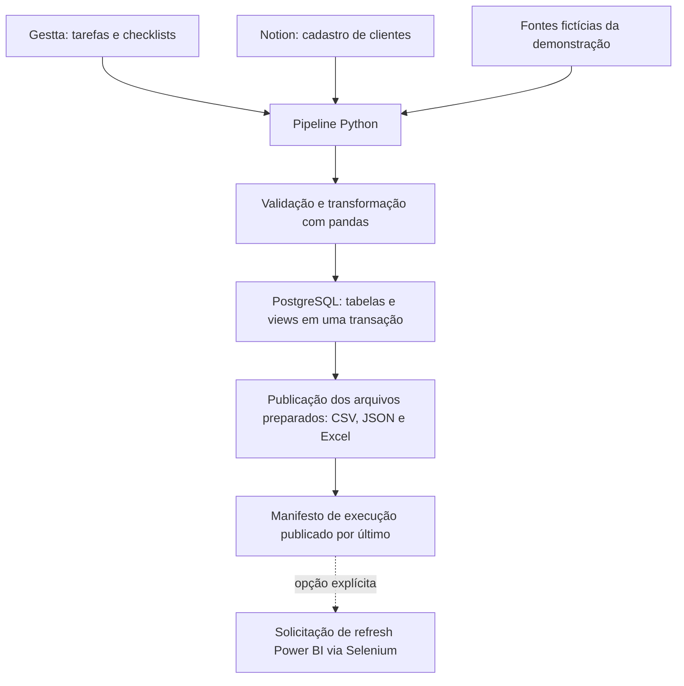

# Gestão Geral BI

[](https://github.com/GabrielTIAlef/gestao_geral/actions/workflows/tests.yml)

Pipeline de dados operacionais em **Python e PostgreSQL**: integra tarefas e
cadastros de clientes, valida as fontes e publica tabelas, views SQL e arquivos
para análise. Inclui demonstração com dados fictícios, testes de falhas e
integração contínua.

Esta versão pública utiliza nomes de etapas, filtros e registros demonstrativos.
É possível avaliar o ETL sem contas de Gestta, Notion, Slack ou Power BI.

## Problema e objetivo

Dados distribuídos entre ferramentas dificultam relacionar tarefas e clientes e
construir uma base analítica consistente. O projeto centraliza essas fontes em
um fluxo de extração, transformação e carga, com validações antes de substituir
os dados publicados.

O foco desta entrega é a confiabilidade da base para BI. O repositório não
inclui arquivos `.pbix`, medidas DAX ou capturas de dashboards. Não apresenta
métricas comprovadas de economia de tempo ou desempenho produtivo.

## Arquitetura



As fontes fictícias substituem os coletores reais na demonstração. Os arquivos
são preparados antes da carga, mas publicados depois do commit do banco.
**Não há transação distribuída** entre PostgreSQL e sistema de arquivos.

## Decisões de engenharia

| Necessidade | Implementação |
| --- | --- |
| Integrar fontes da mesma execução | Pipeline coleta Notion e Gestta; reprocessamento de CSV exige manifesto com hashes válidos. |
| Evitar lotes parciais silenciosos | Falhas de extração, contratos inesperados, chaves inválidas e lotes totais vazios interrompem a carga. |
| Preservar tabelas e dependências | Schema validado, `DELETE` e inserção na mesma transação; views sem `DROP ... CASCADE`. |
| Evitar cargas concorrentes | Advisory locks no PostgreSQL protegem execução e publicação. |
| Preservar zeros iniciais | CNPJ como texto; entrada numérica é rejeitada, sem tentar reconstruir o identificador. |
| Detectar arquivos incompatíveis | Arquivos temporários e manifesto com SHA-256 publicado por último. |
| Acompanhar falhas | Logs por etapa, contagens, manifesto e testes de rollback. |

A integração principal usa `LEFT JOIN` das tarefas com o cadastro Notion pelo
código do cliente. Exige chave única no cadastro e mantém tarefas sem
correspondência, registrando sua contagem.

## Demonstração local

Pré-requisitos deste roteiro: **Windows, Python 3.12 e binários portáteis do
PostgreSQL 18.6**. Consulte o [guia de reprodução](docs/REPRODUCAO.md) para obter
e localizar os binários. Na raiz do repositório, em PowerShell:

```powershell
python -m venv .venv
.\.venv\Scripts\python.exe -m pip install -r requirements-lock.txt
.\.venv\Scripts\python.exe -m pip check

# Ajuste para o diretório bin do PostgreSQL que você extraiu.
$PgBin = (Resolve-Path '.local-test\runtime\pgsql\bin').Path
.\.venv\Scripts\python.exe -X utf8 scripts/validate_postgres.py --pg-bin "$PgBin" --demo
```

O comando cria um cluster temporário local, executa a suíte completa e a
demonstração, e encerra o servidor ao terminar. Não exige `.env` nem credenciais
corporativas. O script não baixa PostgreSQL automaticamente.

A demonstração contém **5 tarefas, 2 clientes na fonte Notion e 4 itens de
checklist**, incluindo uma tarefa sem cadastro correspondente. Gera em
`data/demo/`: `gestta.csv`, `notion.csv`, `gestta.json`, `resultado.xlsx` e
`latest_run.json`. Esses arquivos e o cluster local são ignorados pelo Git.

## Testes e evidências

- **72 testes aprovados no Windows**, em duas instalações novas, sem falhas,
  erros ou testes ignorados: [relatório](docs/ETAPA_3_VALIDACAO.md) e
  [resultado registrado](docs/evidence/etapa3_resultado.json).
- **14 testes com PostgreSQL real**, cobrindo cargas, views, rollback de dados
  e DDL, concorrência, CNPJ textual e fluxo com HTTP simulado. Os demais cobrem
  transformação, configuração e tratamento de falhas.
- **Execução aprovada no GitHub/Linux** após a integração do CI:
  [registro da execução](https://github.com/GabrielTIAlef/gestao_geral/actions/runs/39342727864).
  Novas propostas e envios à `main` executam a suíte com PostgreSQL obrigatório;
  consulte [testes automáticos](docs/TESTES_AUTOMATICOS.md).

Para executar somente os testes disponíveis sem iniciar PostgreSQL:

```powershell
.\.venv\Scripts\python.exe -X utf8 scripts/run_tests.py
```

Nesse modo os testes PostgreSQL são explicitamente ignorados: **não equivale à
validação completa**. O CI usa `--require-postgresql` e falha se houver omissões.

## Organização do código

| Caminho | Responsabilidade |
| --- | --- |
| [src/pipeline.py](src/pipeline.py) | Coordena fontes, transformação, carga e saídas. |
| [src/extracao/](src/extracao/) | Coletores Notion e Gestta, sem integrações na importação. |
| [src/transformacao/PBI_OS.py](src/transformacao/PBI_OS.py) | Normalização, validação da junção e definições das views. |
| [src/transformacao/CS.py](src/transformacao/CS.py) | Coleta e validação dos checklists. |
| [src/database.py](src/database.py) | Transações, tipos, schema e locks. |
| [src/etl_support.py](src/etl_support.py) | Validações, HTTP, arquivos temporários e manifesto. |
| [src/automacao/](src/automacao/) | Provisionamento de token e refresh opcional pelo navegador. |
| [examples/synthetic.py](examples/synthetic.py) | Fontes fictícias dos testes e da demonstração. |
| [scripts/](scripts/) e [tests/](tests/) | Execução reproduzível e testes. |
| [.github/workflows/tests.yml](.github/workflows/tests.yml) | CI com PostgreSQL descartável. |

As tabelas gerenciadas são `notion_folha`, `notion_dados`,
`gestta_relatorios` e, com checklists habilitados, `cs_check`.
As views são `bi_final`, `"Worflow_CS"`, `worflow_cs_novo` e `bi_operacional`.
A grafia existente foi preservada para manter compatibilidade.

## Integrações reais e configuração

Para avaliar o projeto, prefira a demonstração. Adaptar as integrações reais
exige acesso autorizado, propriedades Notion compatíveis e revisão dos filtros
demonstrativos. O Gestta consulta, por padrão, 12 trimestres: ano anterior,
atual e seguinte.

A configuração está em [.env.example](.env.example); use variáveis de ambiente
ou `.env` local, nunca segredos versionados. O ponto de entrada coordenado é
`python src/pipeline.py`. As opções `--checklists` e `--refresh-powerbi` são
explícitas. A demonstração não aciona o Power BI. Consulte
[SECURITY.md](SECURITY.md) para os cuidados de configuração e os limites da
revisão de segurança.

## Limites conhecidos

- APIs reais e navegador autenticado não foram homologados nesta versão
  pública; as evidências usam respostas simuladas e dados fictícios.
- A automação Power BI solicita atualização, sem confirmar sua conclusão.
- A publicação de arquivos pode falhar após o commit do banco. O erro informa
  essa condição; o leitor de snapshots verifica manifesto e hashes.
- Cargas substituem integralmente os dados gerenciados. Não há carga
  incremental, histórico analítico ou benchmark com volume produtivo.
- Schema incompatível exige migração explícita; não há migração automática
  de um banco de produção preexistente.
- Windows e GitHub/Linux têm evidências de execução. macOS e outras versões
  de Python/PostgreSQL não estão cobertos por essas validações.

## Competências demonstradas

Integração de APIs REST, pandas, SQL analítico, PostgreSQL transacional,
modelagem de chaves e tipos, testes com mocks e banco real, configuração por
ambiente e integração contínua. O projeto demonstra uma base de engenharia
analítica e BI; não implementa modelos preditivos ou experimentos de ciência
de dados.
